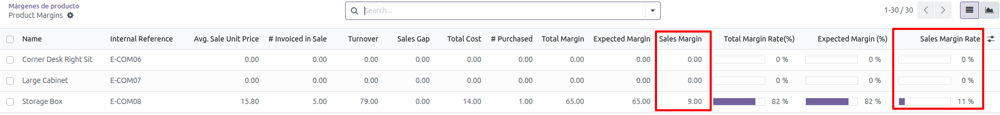
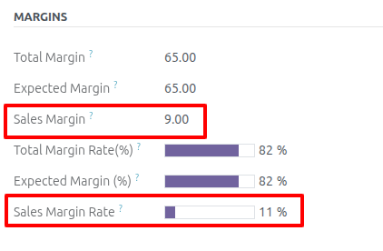

Sales margin fields
------------------

1. Go to *Invoicing* > *Reporting* -> Product Margins
2. Select the values you want to filter by.
3. Click on the *Open margins* button.
4. When the new view is displayed, the two new fields are visible; similarly,
   if you select an element, they will be visible in the form view.

     

     

Field calculations
------------------
* Sales margin = Turnover - (# Invoiced in Sale * Avg. Unit Price [Purchases])
* Sales margin rate = (Sales margin * 100) / Turnover

Avg. Unit Price [Purchases] is the average unit price of the vendor bills
invoiced in the selected period, as computed by the Product Margins report.
Sales margin is therefore an estimate based on purchase invoices, not the
actual cost of goods sold from stock valuation. When the product has no
vendor bills matching the report filters, that average is 0 and the sales
margin equals the turnover.
